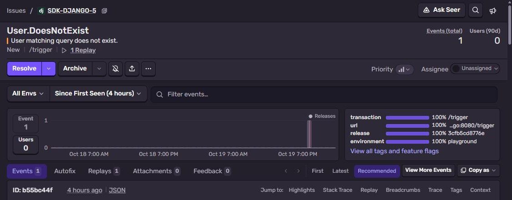
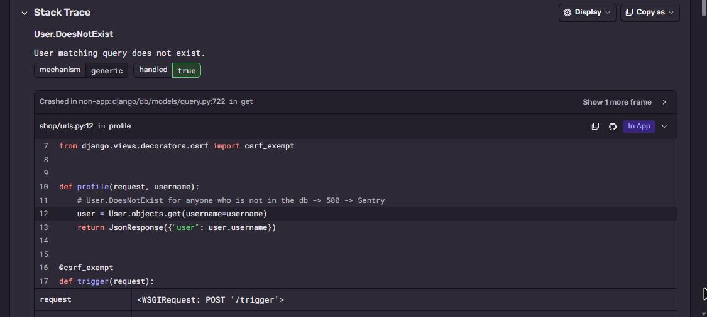

# Sentry + Django

Django project with one view that crashes. Shows what Sentry picks up from Django without any
extra code: request URL, the ORM query, the transaction name.
Part of [Sentry Playground](https://github.com/fsmaster/sentry-playground).



## What you need

- Python 3.12+
- Sentry project with platform **Django**

## 1. Get the DSN

Sentry → **Settings → Projects → (project) → Client Keys (DSN)**, copy it.

## 2. Run it

```bash
git clone https://github.com/fsmaster/sentry-sample-django.git
cd sentry-sample-django
python -m venv .venv
source .venv/bin/activate          # Windows: .venv\Scripts\activate
pip install -r requirements.txt
export SENTRY_DSN="https://<key>@<org>.ingest.us.sentry.io/<project-id>"
python manage.py migrate
python manage.py runserver 8000
```

Now open in browser (or curl) a user which does not exist:

```bash
curl -i http://localhost:8000/profile/nobody/
```

Django answers `500` and exception goes to Sentry.

## 3. Check it in Sentry

**Issues** → `User.DoesNotExist: User matching query does not exist.`

- Stack trace points to `shop/urls.py` line with `User.objects.get(...)`
- **Request** section has the URL and method
- **Trace** link shows the `GET /profile/<str:username>/` transaction with the SQL query span



## How it works

All Sentry code is in `shop/settings.py`:

```python
import sentry_sdk

sentry_sdk.init(
    dsn=os.environ.get("SENTRY_DSN"),
    send_default_pii=False,
    traces_sample_rate=1.0,
)
```

There is no `integrations=[DjangoIntegration()]`. sentry-sdk sees Django is installed and turns the
integration on by itself. It hooks into request handling, so every unhandled exception in a view is
reported, with the request data attached. `traces_sample_rate=1.0` sends every request as transaction,
in production you want something like `0.1`.

`send_default_pii=False` keeps user IP, cookies and logged-in user out of the event. Turn it on only if
you are ok to store that in Sentry.

`/trigger` view is only for the playground dashboard: it runs the same crash but adds a `run_id` tag and
fingerprint, so each button click is new issue.

`/trigger` also takes an optional `"dsn"` in the body. The playground sends it when a visitor checks
**Use my DSN**, then only this one event goes to their project (a separate client, the global one is untouched).

## Production

The Dockerfile runs it with gunicorn. Workflow `.github/workflows/image.yml` builds the image, pushes it
to GHCR and creates Sentry release `sample-django@<sha>` with commits.

```bash
docker build -t sentry-sample-django .
docker run --rm -p 8080:8080 -e SENTRY_DSN="..." sentry-sample-django
curl -i localhost:8080/profile/nobody/
```

## Troubleshooting

| Symptom | Why |
|---|---|
| No event, but you see Django yellow debug page | Works anyway, debug page and Sentry are independent. Check DSN in the same shell where you run `runserver`. |
| `DisallowedHost` | `ALLOWED_HOSTS` is `["*"]` in the sample, in your project add your host. |
| Events have no SQL spans | `traces_sample_rate` is not set, so only errors are sent. |
